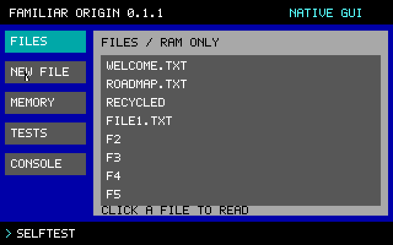

# Familiar Origin

**A small, original operating-system kernel that really boots.** This is a research prototype, not a Linux distribution or a daily-use operating system.



The first milestone is a complete path from a BIOS boot sector to an interactive freestanding C kernel. The loader, kernel, console, allocator, RAM filesystem and shell were written for this project. GCC/binutils compile them; SeaBIOS and QEMU provide existing firmware and emulated hardware. “From scratch” describes the project’s operating-system code, not its compiler, firmware, CPU architecture or emulator.

## What works now

- Original 512-byte BIOS boot loader, disk loading, GDT and 32-bit protected-mode entry.
- Freestanding C kernel, without Linux, libc, a host runtime or unresolved runtime symbols.
- Original 320×200 VGA graphical desktop, PS/2 mouse and keyboard, and a COM1 serial console.
- Native Files, New File, Memory, Tests and Console views sharing the kernel actions.
- Safe new-file creation with next-unused-number suggestions and confirmed deletion.
- Browser companion controls with visible commands, short aliases, bounded natural phrases and safe typo suggestions.
- Separate browser Transformer lab: real training, visible loss/predictions, stop control and learned-weight download.
- Human-readable shell: help, about, cpu, mem, alloc, selftest, ls, cat, new, write, rm, echo, clear, halt, and run for the built-in utilities. The kernel shell itself also accepts one-letter shortcuts (h, l, r, w, n, d and others) and a few plain words such as read, delete, list and show files.
- Bounded 64 KiB bump allocator with 16-byte-aligned allocations.
- Eight RAM-only files, each holding up to 511 bytes, with create/read/update/remove operations.
- Bounded input, error handling and recovery after oversized commands.
- No login or hidden password entry in this single-user VM prototype. No passwords are stored.
- Automated VM interaction and actual PS/2 keyboard tests, plus host ASan/UBSan core tests.

## Use it in a browser

The public browser VM is at https://zqx.lat/familiar-origin/ . It executes the same image using the existing v86 WebAssembly emulator, with guest networking disabled. For 0.1.1, `node tests/test_browser.mjs` passed in Microsoft Edge 158 on Windows 11 against a local server serving these files ([evidence/browser-qa.json](evidence/browser-qa.json)) and in headless Chromium on Linux against the public page ([evidence/browser-qa-public.json](evidence/browser-qa-public.json)). Each run covers boot, commands and typo correction, RAM file create, read and confirmed delete, pause/resume, restart cancel and confirm, the Transformer lab and the licence links, with no request to another origin. Those are automated headless runs, not tests of other browsers or devices. Edge hosts the VM; it is not running inside the guest.

The separate [Transformer lab](https://zqx.lat/familiar-origin/hello.html) genuinely learns its Hello World output in a browser worker. It is not a guest application and does not control commands. See [future research](docs/FUTURE_RESEARCH.md) for neural task learning, MCP, networking, hardware and language goals.

The standalone browser files are in `browser-site/dist/`. Serve that directory over HTTP; opening `index.html` directly as a file will not reliably load WebAssembly and disk assets. No Node packages are needed at runtime. `node tests/test_v86.mjs` checks the bundled WebAssembly engine outside a browser. It does not replace UI testing.

## Try it safely in a virtual machine

Prerequisites on an x86-64 Linux development machine: GCC with freestanding `-m32` code generation, GNU binutils, Make, Python 3 and QEMU’s x86 system emulator with its firmware. No 32-bit libc is required. Install these using your normal trusted OS package manager if they are not already available.

```sh
make
make test
make run
```

The generated disk is `build/origin.img`, a 1 MiB raw image. `make run` uses QEMU software emulation, no virtual network adapter, and a terminal serial console. To see VGA in a QEMU window, omit `-display none` from the command printed by `make run`. Type `help` to explore. `halt` stops the guest CPU; close QEMU separately. RAM files disappear whenever the VM restarts.

```text
write note.txt Hello from my own kernel
cat note.txt
alloc 128
mem
selftest
```

The release bundle (the zip on the GitHub release page) includes a prebuilt disk in `build/`. The git repository does not, because `build/` is ignored; the same image is committed as `browser-site/dist/assets/origin.img`. Always rebuild from source to verify the image. **Do not flash this image to a PC, phone or an existing data disk.** It has no installer, no partition management, no recovery tools and no persistent filesystem.

## Recorded result and timing

The development timer was recorded at **2026-11-11 06:29:48 UTC**. The first observed QEMU boot reached the shell with the built-in self-test passing at **06:36:54.944 UTC**, approximately **7 minutes 7 seconds** later, including local emulator setup. The first image’s kernel was 5,024 bytes. The subsequent tested version added a usable allocation command and separated ELF segments; its kernel was 8,204 bytes. The current graphical kernel is 12308 bytes.

That is a measurement of the first minimal prototype milestone, not the time to build a complete usable OS. It does not establish that this project is faster or better than commercial operating-system teams. Desktop applications, isolation, production graphics, storage, drivers, security, compatibility and years of maintenance are different work, much of it not started here. We have no matched commercial benchmark.

The current [VM report](evidence/boot-test.json) records **58 checks**, the image hash, QEMU version and observed timings. See the [serial transcript](evidence/serial-transcript.txt), [first-boot record](evidence/first-boot.json), [test run](evidence/final-test-run.txt) and [measurement notes](docs/MEASUREMENTS.md). A roughly 0.1-second QEMU launch-to-prompt observation is environment-specific and is not a hardware performance benchmark.

## Hardware and application status

| Target | Current status |
| --- | --- |
| QEMU x86 PC with BIOS and IDE disk | Built and boot-tested |
| Physical Windows-capable PC | Not tested; legacy BIOS/CSM only in this design |
| Modern UEFI-only x86-64 PC | Not supported yet |
| ARM64 QEMU machine | Planned; no ARM kernel yet |
| Actual Android phone/tablet | Not supported; requires a specific supported board, unlocked boot chain and drivers |
| Claude, Codex and Microsoft Edge | Not supported; no network stack, TLS, browser, POSIX/Windows ABI or JavaScript runtime |

Running this VM inside another operating system does not make that operating system’s applications run inside this kernel. An ARM build alone would not make arbitrary Android hardware bootable. The [roadmap](docs/ROADMAP.md) keeps those milestones separate.

## Security and accessibility

This is a single-address-space, ring-0 research kernel. Interrupts stay disabled, input is polled, and there is no scheduler, user mode, paging, permission system, cryptography, sandbox or persistent storage. A password-free prompt here is not a secure authentication feature. Do not use sensitive data with it.

The long-term design is human- and agent-friendly: explicit actions, readable errors, predictable command interfaces, visible progress and recoverable operations. The [accessibility plan](docs/ACCESSIBILITY.md) specifies optional password visibility and user-controlled sign-in choices for a future real authentication system. No local or cloud AI agent is embedded in the kernel today. The separate toy training lab is not an assistant.

## Build and test details

`make test-host` runs core tests with AddressSanitizer and UndefinedBehaviorSanitizer and validates the raw image. Leak detection is disabled by default because the initial container’s ptrace environment prevents LeakSanitizer from running; these tests do not dynamically allocate host memory. Set `ASAN_OPTIONS=detect_leaks=1` on a compatible host if desired.

`make test-boot` boots the raw disk through actual emulated BIOS, checks commands through serial I/O, injects PS/2 key events and captures the VGA framebuffer. It uses local pipes rather than network sockets. It terminates only its own test VM. Override `QEMU` with the path to a local wrapper if needed.

`node tests/test_commands.cjs` checks bounded language/alias behavior. `node tests/test_transformer.cjs` checks three training seeds and 18 finite-difference gradient samples. The Transformer memorizes one phrase; those results do not measure general language ability.

Tests are evidence for the narrow implemented features, not a formal verification or a security audit. No GitHub Actions job or paid service is required to build or test this project.

## License status

No open-source license has been selected for this new project yet. Public source availability does not itself grant an open-source license. Third-party tools retain their own licenses. The optional browser VM in `browser-site/dist/vendor/` redistributes unmodified v86 0.5.473 (BSD-2-Clause, with MIT, SoftFloat, Zstandard and Rust standard-library parts) and the Debian SeaBIOS 1.16.3-2 system and VGA firmware (LGPL), with their notices, license texts and corresponding source; it does not include GCC or QEMU. See [NOTICE](NOTICE) and `browser-site/dist/licenses.html`. `tools/hydrate_browser_vendor.py` is optional and is not part of the build: run by hand, it downloads those third-party files again from npm, Debian and GitHub (it needs network access and `dpkg-deb`) and checks them against the recorded hashes.

## Versions and mirrors

`VERSION` holds the current version number. The public repository is the source of truth, and a private mirror carries the same commits and tags; [SYNC.md](SYNC.md) describes how the two are kept in step and how the website and the release bundle relate to a tagged commit.
