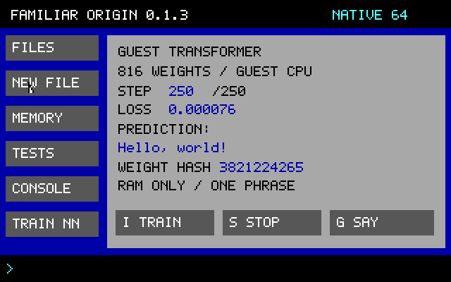

# Familiar Origin 0.1.3

An original research kernel with a real graphical desktop, a small text editor and a Transformer that actually trains inside the guest. **The default native build is x86-64.** A separately tested 32-bit compatibility build runs in the v86 browser emulator.



## Implemented and tested

- Original BIOS loader and freestanding C kernel, without Linux or a host runtime.
- Native x86-64 long-mode entry, identity-mapped paging, 64-bit pointers and SSE2 scalar floating-point operations. The CPU command reads EFER.LMA to verify the active mode.
- Separate 32-bit protected-mode build with x87 floating point, retained for browser compatibility.
- Original 320×200 framebuffer GUI, PS/2 keyboard/mouse, serial console and shared GUI/command operations.
- Native text editor: open a RAM file, type multiple lines, move left/right or Home/End, Delete/Backspace, Ctrl+A, Ctrl+S, and confirm before discarding unsaved changes. Plain ASCII text, maximum 511 bytes per file, not Word-format compatibility.
- Eight RAM files, safe no-overwrite creation, next-unused-number naming and confirmed deletion. Files and model weights disappear on restart.
- An 816-parameter causal Transformer trained from random weights in guest machine code. All forward/backpropagation, Adam updates and greedy generation occur in the guest. No browser model is called.
- Mouse-only movement restores/draws at most 60 framebuffer bytes rather than redrawing 64,020 bytes. A 1,000-movement test checks exact pixel restoration and no full redraw. This is not a measured Windows latency comparison.
- Browser companion controls, a table of every command the page accepts with its short keys and plain words, bounded natural phrases and deterministic read-only typo correction. These suggestions are not yet neural.

## Native programming language

Origin Script v0 is a real bounded guest interpreter with integer expressions, variables, print/say, repeat/end and guest-training actions. Try `code print 2+3*4`, or edit a `.fo` RAM file and use `run NAME.fo`. See [syntax, bounds and examples](docs/ORIGIN_SCRIPT.md). It is not Python, a neural parser or a fastest-language claim.

## Build and run

Prerequisites: GCC, GNU binutils, Make, Python 3 and the appropriate QEMU system emulator from trusted sources. No 32-bit libc is needed.

```sh
make                         # Native x86-64 image in build64/origin.img
make test                    # Host sanitizers, model/editor tests, real 64-bit VM tests
make run                     # Serial console, no virtual network adapter
make ARCH=32                 # Separate compatibility image in build32/origin.img
make ARCH=32 test
```

For a graphical QEMU window, omit `-display none` from the command printed by `make run`. Both targets use a 1 MiB raw BIOS disk, not a bootable ISO or UEFI installer. **Do not flash it onto a real disk or phone.** There is no partition manager or recovery installer.

The release bundle (the zip on the GitHub release page) contains the source and both prebuilt images, in `build64/` and `build32/`. The git repository does not carry those two folders, because they are ignored; the same two images are committed as `browser-site/dist/assets/origin64.img` and `browser-site/dist/assets/origin.img`. Rebuilding reproduces the disk with the recorded toolchain; a different compiler version produces different bytes. `make test` uses only disposable VM disk snapshots and terminates its own test process.

## Train inside the OS

Click **TRAIN NN** in the native sidebar, then **I TRAIN**, or enter `hello` / `i` / `run hello` in the command field. The guest displays the step number, loss, prediction and a changing weight fingerprint. Training is bounded to 250 steps, with input polled between steps. Use `stop` / `s` or the native Stop button to interrupt. `generate` / `g` generates from the current weights.

The training target is one phrase, “Hello, world!”. The inference routine does not return that constant: it repeatedly evaluates the learned matrices and selects predicted tokens. Initial random predictions differ; successful training changes the weights, reduces loss and produces the phrase. This proves memorization, not general language understanding or an OS command predictor.

Architecture: learned token/position embeddings, one causal scaled dot-product attention head, residual paths, a tanh feedforward layer and a learned output projection. This small variant omits layer normalization/dropout. No downloaded weights, GPU, external inference or personal data is used. Float math helpers are implemented in freestanding C. Node's optional browser reference is separate and not needed by the guest.

## Edit a file

Create a file from **New File**, then select it under **Files** and choose **Edit**. Alternatively use `edit NAME` or `o NAME`. The native editor saves through the same kernel write operation as the shell. Escape asks before discarding changed text. Editing does not grant persistent storage: restart still erases everything.

Shortcuts include `h` help, `l` files, `r NAME` read, `n NAME TEXT` new, `d NAME` delete, `m` memory, `t` tests and `q` halt. The browser additionally recognizes selected natural phrases and offers visible suggestions. File names and payloads are not spell-corrected.

## Browser compatibility build

The public browser VM is at https://zqx.lat/familiar-origin/ . It runs the **32-bit** image in the existing v86 WebAssembly emulator, with guest networking disabled; v86 does not support x86-64 long mode. The guest still performs its own Transformer training and file editing. Edge hosts the VM; Edge is not an application inside the guest.

To serve it yourself, serve `browser-site/dist/` over loopback HTTP, for example:

```sh
python3 -m http.server 8766 --bind 127.0.0.1 --directory browser-site/dist
```

Open http://127.0.0.1:8766/ in an existing browser. Do not use `file://` for WebAssembly assets.

The [`local/`](local/README.md) folder has a stricter local-only server (`python3 local/serve.py`, port 8767) and, for Windows, scripts that start it, open the page and stop it again.

For 0.1.3, `node tests/test_browser.mjs` passed in Microsoft Edge on Windows 11 against a local server serving these files ([evidence/browser-qa.json](evidence/browser-qa.json)) and in headless Chromium on Linux against the public page ([evidence/browser-qa-public.json](evidence/browser-qa-public.json)). Each run covers boot, commands and typo correction, RAM file create, read and confirmed delete, guest Transformer training to the target phrase, an Origin Script statement, pause/resume, restart cancel and confirm, the reference lab and the licence links, with no request to another origin. Those are automated headless runs of the 32-bit build, not tests of other browsers or devices. The Node v86 boot and training tests also pass. The script tests http://127.0.0.1:8767/ unless `FO_URL` names another address; with the `http.server` example above, run `FO_URL=http://127.0.0.1:8766/ node tests/test_browser.mjs`.

## Evidence and timing

- [64-bit QEMU suite](evidence/boot-test-64.json) and [32-bit QEMU suite](evidence/boot-test-32.json).
- [64-bit actual guest training](evidence/guest-transformer-test-64.json), [32-bit actual guest training](evidence/guest-transformer-test-32.json), and serial transcripts.
- [WebAssembly emulator test](evidence/v86-node-test.json).
- [Second-machine check](evidence/second-machine-check.json): the release images, and a rebuild from source, under an older QEMU and compiler on another machine.
- `make test-nn` checks three seeds and 18 finite-difference float32 gradient samples. `make test-gui` checks pointer restoration, editor save/discard and bounds with ASan/UBSan.

First implementation began at 2026-11-11 06:29:48 UTC; the original minimal 32-bit shell first booted at 06:36:54.944 UTC, **7 minutes 6.944 seconds** later. Graphics, editing, neural training and 64-bit support were later milestones. This is not a time-to-complete-OS measurement or a matched comparison against commercial teams.

LeakSanitizer is disabled in the supplied host-test commands because the original container's ptrace environment prevents it from running. AddressSanitizer and UndefinedBehaviorSanitizer remain enabled. Set `ASAN_OPTIONS=detect_leaks=1` on a compatible host if desired.

## Limits and roadmap

This is not a daily-use OS or a security sandbox. It runs in ring 0, without process isolation, general exception recovery, scheduling, persistent storage, networking, MCP, Python, GPU drivers or application compatibility. The 64-bit identity mapping enables long mode but does not isolate anything. Interrupts remain disabled and input is polled. No authentication system exists; the password-free prompt is not a security feature. It has been tested only under QEMU (both builds) and v86 (the 32-bit build); it has never been booted on physical hardware.

Native Edge, Claude, Codex, ARM64/Android/Apple hardware, modern UEFI, continual neural task learning, robust fault recovery and other platforms remain future work. No host security settings, device firmware or boot partitions were changed. See [architecture](docs/ARCHITECTURE.md), [accessibility](docs/ACCESSIBILITY.md), [roadmap](docs/ROADMAP.md) and [research goals](docs/FUTURE_RESEARCH.md).

### Known issues in 0.1.3

A review after the release found these. The first two are in the browser page and will be fixed with the next tagged release; the last two are in the kernel and need a new disk image.

- In the browser command field, `run s`, `run g` and `run o` are passed to the guest as `run stop`, `run generate` and `run edit`, which the kernel refuses. Use `s`, `g` and `o NAME` instead.
- The browser page asks before `write` replaces a file only when that file is in its own file list. After creating or saving a file in the native desktop, press the page's **Refresh** button before using `write` on it.
- Native editor: text that begins with spaces is saved without those spaces, and the editor then keeps treating the text as unsaved. Leave with Escape and choose Discard; the file holds the text without the leading spaces.
- Origin Script: a program of exactly 64 lines must not end with a newline, because the empty line after it is counted as a 65th line.

## Original code and licensing

The boot loader, kernel, GUI, editor, tiny neural implementation, Origin Script interpreter and tests were written for this project. Existing GCC/binutils, QEMU, SeaBIOS and v86 are not claimed as inventions. No open-source license has been selected for the project's original code; public availability alone does not grant one.

Third-party tools retain their own licenses. The optional browser VM in `browser-site/dist/vendor/` redistributes unmodified v86 0.5.473 (BSD-2-Clause, with MIT, SoftFloat, Zstandard and Rust standard-library parts) and the Debian SeaBIOS 1.16.3-2 system and VGA firmware (LGPL), with their notices, license texts and corresponding source; it does not include GCC or QEMU. See [NOTICE](NOTICE) and `browser-site/dist/licenses.html`. `tools/hydrate_browser_vendor.py` is optional and is not part of the build: run by hand, it downloads those third-party files again from npm, Debian and GitHub (it needs network access and `dpkg-deb`) and checks them against the recorded hashes.

## Versions and mirrors

`VERSION` holds the current version number. The public repository is the source of truth, and a private mirror carries the same commits and tags; [SYNC.md](SYNC.md) describes how the two are kept in step and how the website and the release bundle relate to a tagged commit.
